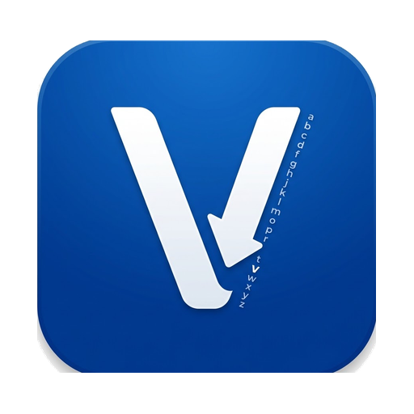
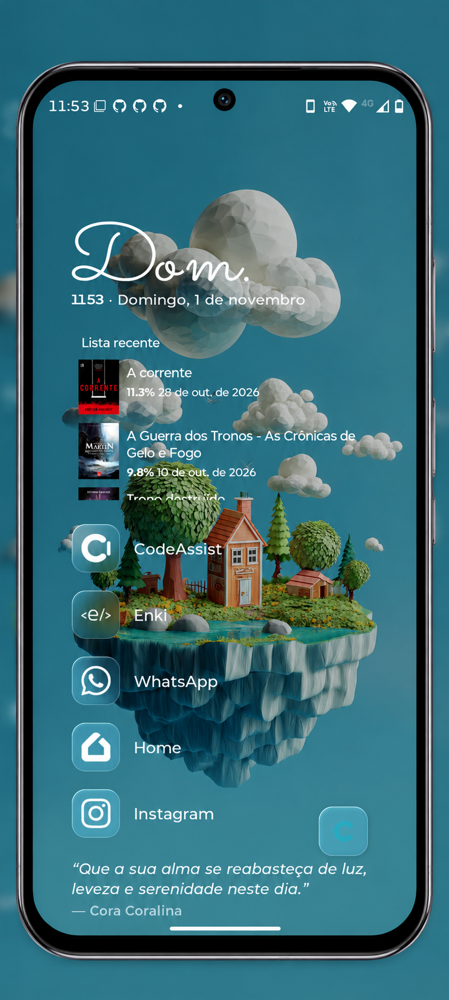
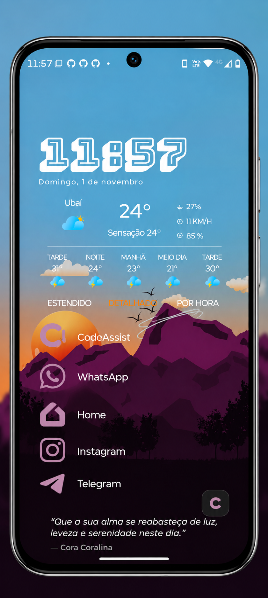
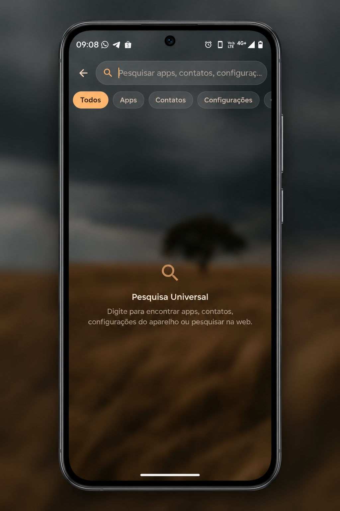
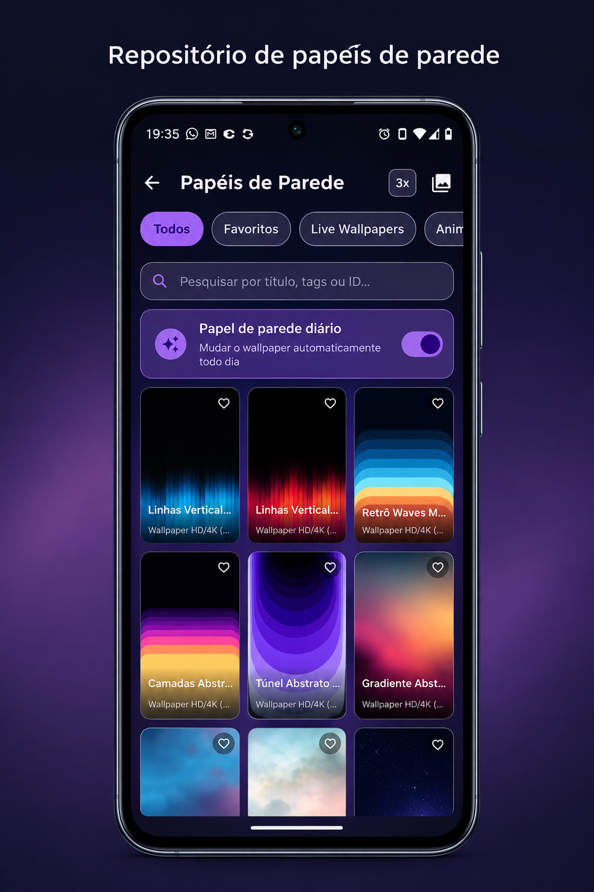

  

<h1 align="center">Viagara Launcher</h1>

  <strong>Launcher minimalista, ergonômico e veloz para Android, baseado em lista vertical para uso com apenas uma mão.</strong>

  
  
  
  

  
  
  
  
  

  <a href="#personalizacao">Personalização</a> •
  <a href="#pesquisa">Pesquisa</a> •
  <a href="#papeis-de-parede">Wallpapers</a> •
  <a href="#recursos">Recursos</a> •
  <a href="#download">Download</a> •
  <a href="#documentacao">Documentação</a>

---

## 🎨 Personalize do Jeito que Quiser

  
  

- **Relógio & Data:** Fontes artísticas, 3D ou minimalistas com controle de tamanho e alinhamento.
- **Widgets Integrados:** Clima detalhado por hora, livros e leituras recentes, citações diárias e Now Playing.
- **Ícones Adaptativos:** Suporte a pacotes de terceiros (*Icon Packs*), efeito vidro translúcido (*Squircle Glass*) e cores dinâmicas Material You.
- **Layout Flexível:** Defina seus apps favoritos e organize pastas mantendo a tela limpa e fluida.

---

## 🔍 Sistema de Pesquisa Universal

  

- **Busca Unificada:** Encontre apps instalados, contatos, ajustes do sistema (Wi-Fi, Bluetooth, Bateria) ou pesquise direto na web.
- **Filtros Rápidos:** Alterne entre **Todos**, **Apps**, **Contatos** e **Configurações** com um toque.
- **Interface Translúcida:** Foco instantâneo com desfoque de fundo (*blur*) sem perder a visão do wallpaper.

---

## 🖼️ Repositório de Papéis de Parede

  

- **Catálogo HD & 4K:** Galeria integrada com estilos abstratos, minimalistas e paisagens.
- **Live Wallpapers:** Suporte a vídeos e papéis de parede animados com baixo consumo de bateria.
- **Wallpaper Diário Automático:** Rotação automática a cada 24 horas para renovar o visual do aparelho.
- **Cores Dinâmicas:** As cores do sistema e dos ícones adaptam-se imediatamente ao papel de parede escolhido.

---

## ✨ Outros Recursos

- **Ergonomia com Uma Mão:** Lista vertical rápida e scrubber alfabético com física de curva gaussiana.
- **Monitor de Rede:** Velocidade em tempo real na barra de status e identificação dos apps em consumo.
- **Agenda & Tarefas:** Compromissos, tarefas com repetições e sincronização com calendários.
- **Superusuário (Opcional):** Instalação silenciosa de atualizações e visualizador de áudio nativo via root.
- **Backup & Restauração:** Salve e recupere suas configurações facilmente em arquivo JSON.
- **Atualizador Embutido:** Notificação de novidades e atualização direta pelo app via GitHub Releases.

> 🛠️ **Monitoramento Avançado:** Para monitor de processos, RAM e terminal de logs, utilize o app irmão [**MAY Task Manager**](https://github.com/S-Marcos-S/MAY---Task-Manager).

---

## 📥 Download

Baixe o APK da versão mais recente na aba **[Releases](https://github.com/S-Marcos-S/viagra-launcher/releases)**.

- **Requisitos:** Android 8.0+ (Recomendado Android 12+ para cores dinâmicas).

---

## 📚 Documentação & Créditos

- **Documentação:** [Arquitetura](docs/ARCHITECTURE.md) • [Funcionalidades](docs/FEATURES_GUIDE.md) • [Theming](docs/THEMING_AND_UI.md) • [Contribuição](docs/CONTRIBUTING.md)
- **Créditos:** Inspirado nos conceitos de lista do [Niagara Launcher](https://niagaralauncher.app), [LogFox](https://github.com/F0x1d/LogFox), [BatStats](https://github.com/mlm-games/BatStats) e [Grace Launcher](https://github.com/Galaxy-rio/GraceLauncher).
- **Licença:** Distribuído sob a licença [GPL-3.0-or-later](LICENSE).
