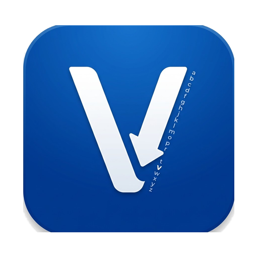
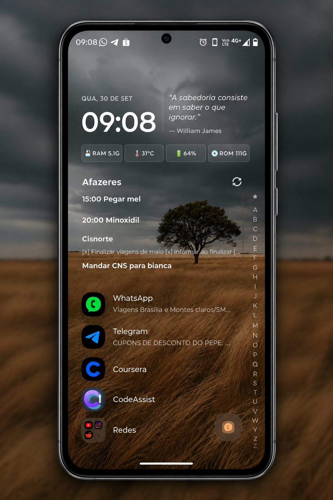
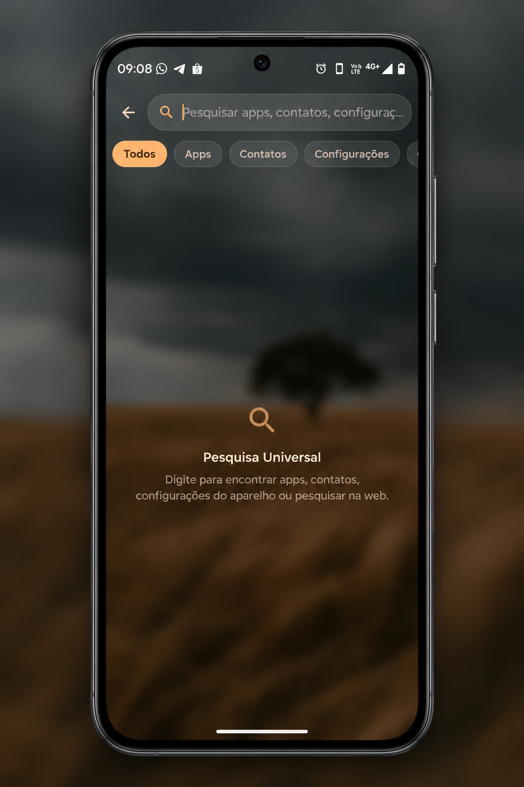
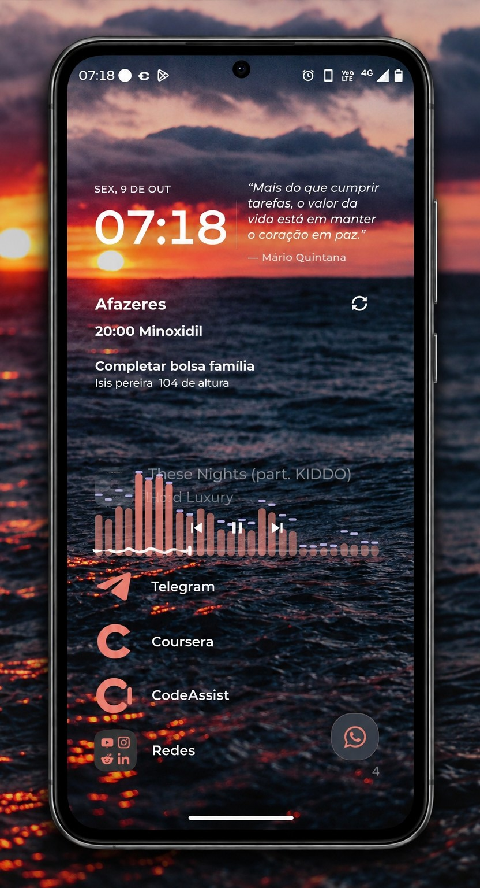
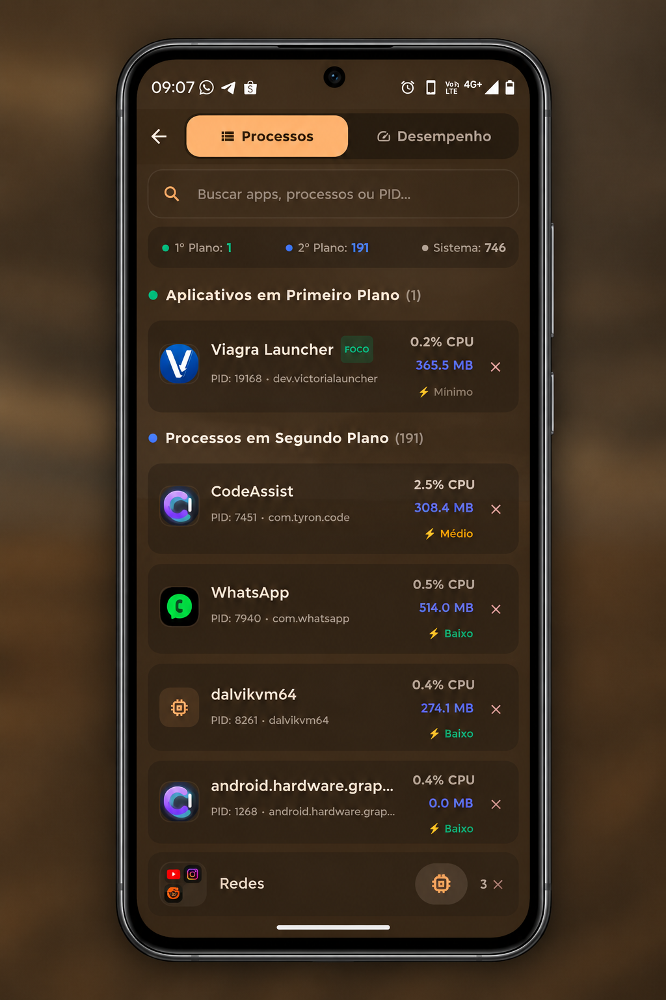
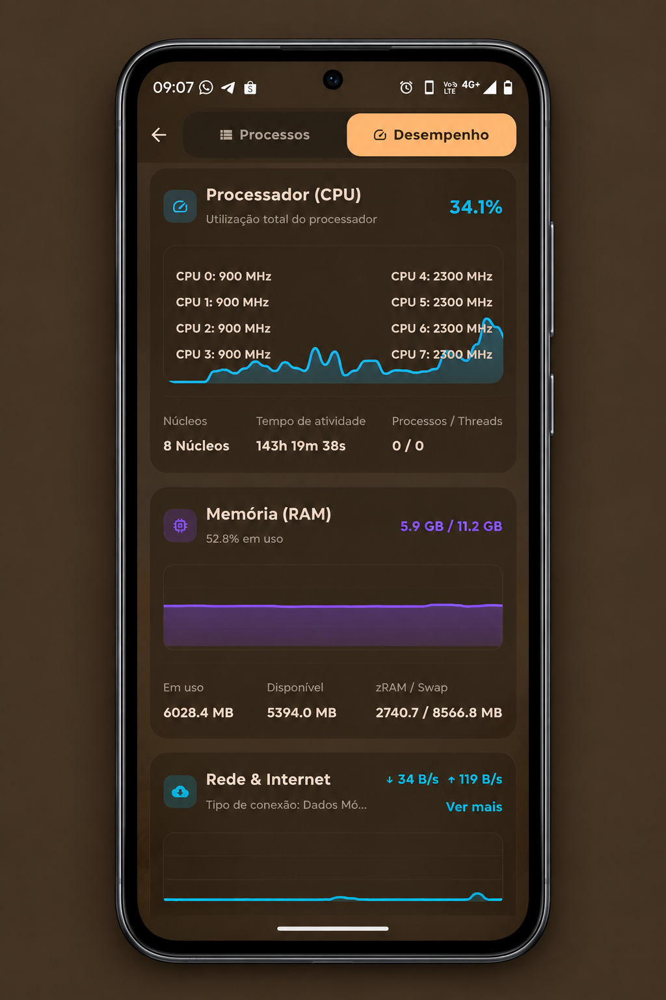
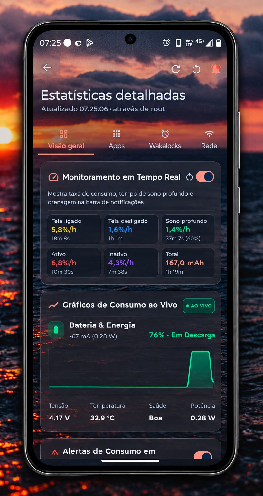

  

<h1 align="center">Viagara Launcher</h1>

  <strong>Launcher minimalista, ergonômico e veloz para Android, baseado em lista vertical e projetado para navegação fluida com apenas uma mão.</strong>

  
  
  
  

  
  
  
  
  
  

  <a href="#-destaques--features">Destaques</a> •
  <a href="#-recursos-para-superusuário">Superusuário</a> •
  <a href="#-download">Download</a> •
  <a href="#-documentação-técnica">Documentação</a> •
  <a href="#-créditos--credits">Créditos</a> •
  <a href="#-licença--license">Licença</a>

---

  
  
  
  
  
  

---

## ✨ Destaques / Features

- **Ergonomia com Uma Mão:** Lista vertical rápida e scrubber alfabético com feedback tátil.
- **Catálogo Oficial de Wallpapers:** Papéis de parede em alta definição com aplicação direta e atualizações automáticas.
- **Temas & Cores Dinâmicas:** Material You integrado, OLED Preto Puro e adaptação imediata às cores do wallpaper.
- **Notificações Integradas:** Prévias sob os apps e pop-up expansível translúcido com histórico de mensagens.
- **Widgets & Now Playing:** Suporte a widgets do Android e controle multimídia na tela inicial.
- **Customização:** Ícones temáticos, suporte a icon packs externos, ocultação de apps e pastas.
- **Atualizador Embutido:** Download e verificação de novidades diretamente pelo app via GitHub Releases.

---

## ⚡ Recursos para Superusuário

*(Ferramentas extras para usuários avançados; o launcher funciona 100% sem root)*

- **Gerenciador de Processos:** Inspeção detalhada de memória/CPU e encerramento forçado de processos em segundo plano.
- **Monitor de Desempenho:** Acompanhamento de taxas de uso de hardware em tempo real.
- **Diagnóstico do Sistema:** Análise profunda de bateria (`batterystats`), rastreamento de anomalias e visualizador de crashes.

---

## 📥 Download

Baixe o APK da versão mais recente diretamente na aba **[Releases](https://github.com/S-Marcos-S/viagra-launcher/releases)**.

> **Requisito Mínimo:** Android 8.0 (API 26) ou superior.  
> **Recomendado:** Android 12+ para extração dinâmica de cores do Material You.

---

## 📚 Documentação Técnica

Para detalhes sobre arquitetura, design de componentes e desenvolvimento, consulte os documentos na pasta [`docs/`](docs/README.md):

- [Arquitetura do Sistema (`ARCHITECTURE.md`)](docs/ARCHITECTURE.md)
- [Guia Completo de Funcionalidades (`FEATURES_GUIDE.md`)](docs/FEATURES_GUIDE.md)
- [Design System & Cores Dinâmicas (`THEMING_AND_UI.md`)](docs/THEMING_AND_UI.md)
- [Sistema de Atualizações Integradas (`UPDATE_SYSTEM.md`)](docs/UPDATE_SYSTEM.md)
- [Dados, Persistência e Memória (`DATA_AND_STORAGE.md`)](docs/DATA_AND_STORAGE.md)
- [Guia de Contribuição (`CONTRIBUTING.md`)](docs/CONTRIBUTING.md)

---

## 🤝 Créditos / Credits

- **[Niagara Launcher](https://niagaralauncher.app)** — Inspiração do conceito ergonômico em lista vertical.
- **[Wallhaven](https://wallhaven.cc)** e seus artistas — Coleção oficial de papéis de parede.
- **[LogFox](https://github.com/F0x1d/LogFox)** — Sistema de captura de logs e diagnóstico.
- **[BatStats](https://github.com/mlm-games/BatStats)** — Telemetria e análise de bateria.

---

## 📄 Licença / License

Distribuído sob a licença [GPL-3.0-or-later](LICENSE).
