# Architecture of Viagara Launcher

Viagara Launcher is a high-performance, single-module Android home-screen launcher built with Kotlin 2.0+, Jetpack Compose, `minSdk 26`, and `compileSdk`/`targetSdk 35`. It is privacy-first: no ads, no analytics, no trackers, and no user accounts.

---

## 🏗️ High-Level System Architecture

```mermaid
flowchart TD
    subgraph UI_Layer["Presentation Layer (Jetpack Compose)"]
        Nav[ViagaraNavHost]
        Home[HomeRoute / HomeScreen]
        AppList[AppListScreen & EdgeScrubber]
        Clock[NiagaraClockWidget & DynamicClockWidget]
        DynBtn[DynamicActionButton]
        MediaUI[NowPlayingWidget]
        Slot[WidgetSlot]
        NetUI[NetworkStatsScreen]
        AgendaUI[AgendaBottomSheet & CreateAgendaSheet]
        BatteryUI[BatteryStatsScreen]
        RootUI[TaskManagerScreen & AppLogViewerDialog]
        WallUI[WallpaperPickerScreen]
    end

    subgraph State_Layer["State & Domain Layer (Coroutines & StateFlows)"]
        PrefsState[Prefs Flow Collectors]
        ScrubState[ScrubState]
        MediaBus[NowPlayingBus]
        NotifBus[NotificationBus]
        NetSpeedState[NetSpeedSettings & Traffic Tracker]
        AgendaState[AgendaRepository]
        BatteryVM[BatteryStatsViewModel]
        TaskState[SystemTaskTelemetry]
        UpdateState[UpdateManager StateFlows]
    end

    subgraph Data_Layer["Data & Persistence Layer"]
        DataStore[(Jetpack DataStore Preferences)]
        AppRepo[AppRepository]
        IconRepo[IconPackRepository]
        Cache[Bitmap LruCache]
        AgendaStore[(Agenda JSON Storage / fsync)]
        WallRepo[WallpaperRepository]
        BackupMgr[BackupManager]
        FilterStore[FilterStorage]
    end

    subgraph System_Layer["Android Framework & System Services"]
        PM[PackageManager]
        WM[WindowManager / BlurBehind / SystemAlertWindow]
        Host[ViagaraAppWidgetHost / View]
        MediaSvc[NowPlayingListenerService]
        AccessSvc[ViagaraAccessibilityService]
        SpeedSvc[SpeedMonitorService]
        SyncSvc[AgendaSyncService]
        LogSvc[AppLogCaptureService]
        BatteryStats[RootBatteryStatsCollector / dumpsys]
        Shell[ShellRunner / su]
        NetStatsMgr[NetworkStatsManager / TrafficStats]
        Updater[GitHub Releases API / MediaStore]
    end

    Nav --> Home
    Home --> Clock & DynBtn & MediaUI & Slot & AppList
    Nav --> NetUI & AgendaUI & BatteryUI & RootUI & WallUI
    Home -.-> PrefsState
    AppList -.-> ScrubState
    MediaUI -.-> MediaBus
    Home -.-> NotifBus
    NetUI -.-> NetSpeedState
    AgendaUI -.-> AgendaState
    BatteryUI -.-> BatteryVM
    RootUI -.-> TaskState

    PrefsState --> DataStore
    AppRepo --> PM & Cache
    IconRepo --> PM & Cache
    Slot --> Host
    MediaBus --> MediaSvc
    Home --> AccessSvc
    NetSpeedState --> SpeedSvc
    SpeedSvc --> NetStatsMgr
    AgendaState --> AgendaStore & SyncSvc
    BatteryVM --> BatteryStats
    BatteryStats --> Shell
    TaskState --> Shell
    UpdateState --> Updater
    RootUI --> LogSvc
```



---

## 📦 Package Layout (`dev.viagaralauncher`)

```
dev.viagaralauncher
├── MainActivity.kt                      Single activity, window insets, status-bar peek, navigation host
├── ViagaraApp.kt                       Application singleton; initializes repositories, Prefs, widget host, alarms
├── agenda/
│   ├── AgendaBottomSheet.kt            Agenda sheet UI with task timeline, check-offs, and date selectors
│   ├── AgendaModels.kt                 Data models for tasks, events, recurrence rules, and priorities
│   ├── AgendaNotificationReceiver.kt   BroadcastReceiver for reminder alarms, dismissals, and snoozing
│   ├── AgendaNotificationService.kt    Heads-up notification dispatcher for agenda deadlines
│   ├── AgendaRecurrenceService.kt      Recurrence engine (daily, weekly, monthly, custom intervals)
│   ├── AgendaRepository.kt             Local JSON persistence engine with atomic replacement and fsync
│   ├── AgendaSyncService.kt            Bidirectional sync engine with external calendars & local files
│   └── CreateAgendaSheet.kt            Task and event creation modal bottom sheet
├── backup/
│   ├── BackupAlarmReceiver.kt          Scheduled periodic backup trigger
│   ├── BackupData.kt                   Serializable full-launcher snapshot (preferences, folders, layout)
│   └── BackupManager.kt                Automated and manual backup/restore via SAF and local storage
├── battery/
│   ├── AdvancedDrainTracker.kt         Historical per-app drain calculation over screen-on and screen-off windows
│   ├── AppLabels.kt                    Package-to-label resolver with memory caching
│   ├── BatteryStatsEvents.kt           UI event declarations for the battery diagnostics screen
│   ├── BatteryStatsParser.kt           High-performance parser for raw dumpsys batterystats outputs
│   ├── BatteryStatsViewModel.kt        ViewModel managing live telemetry, discharge rates, and charts
│   ├── DetailedStatsCollector.kt       Deep inspection of wakelocks, alarm triggers, and sensor consumption
│   ├── DrainNotificationManager.kt     Proactive high-drain alerts during device sleep
│   ├── DrainNotificationReceiver.kt    Broadcast receiver for drain notification actions
│   ├── DrainState.kt                   Battery drain threshold models and monitoring states
│   ├── EnforceDozeController.kt        Root-assisted aggressive Doze enforcement
│   ├── RootBatteryStatsCollector.kt    Root-elevated telemetry collector using persistent su shell
│   └── ShellRunner.kt                  Process pipe runner for non-blocking su and sh commands
├── clock/
│   ├── ClockEvents.kt                  Clock interaction and selection events
│   ├── ClockFace.kt                    Composed clock faces (Niagara, Retro, Typography, Minimal, etc.)
│   ├── ClockFontStore.kt               Dynamic font loader and typeface caching for clock styles
│   ├── ClockModels.kt                  Clock style schemas, alignment, and display parameters
│   ├── ClockNotificationManager.kt     Clock tick notification engine for live home rendering
│   ├── ClockRepository.kt              Persistence and retrieval of custom clock configurations
│   ├── ClockSpacing.kt                 Dynamic horizontal and vertical clock metric computations
│   ├── DynamicClockWidget.kt           Composable widget adapting clock layouts in real-time
│   ├── GraceClockFonts.kt              Curated artistic font registry
│   └── SeparatedClockGlyphs.kt         Isolated hour/minute glyph rendering
├── data/
│   ├── AppInfo.kt                       Component name + label; flattened key representation
│   ├── AppRepository.kt                 PackageManager querying, launch intents, package change receivers
│   ├── CustomClockStyle.kt              Custom user clock styling data structures
│   ├── DailyQuoteManager.kt             Daily inspirational quote loader and local caching
│   ├── Folder.kt                        Folder data model + JSON persistence + tokenized favorites
│   ├── HomePaddings.kt                  Vertical and horizontal padding slots
│   ├── IconPackRepository.kt            Icon-pack discovery, appfilter.xml parsing, drawable resolution
│   └── Prefs.kt                         DataStore<Preferences> schema, atomic flows, reactive keys
├── media/
│   ├── NowPlayingBus.kt                 Central state holder for active media sessions
│   ├── NowPlayingListenerService.kt     NotificationListenerService tracking MediaSessions & playback
│   └── NowPlayingWidget.kt              Now Playing card, transport controls, album art, swipe to dismiss
├── network/
│   ├── NetSpeedSettings.kt              DataStore schema & helpers for speed thresholds and update intervals
│   ├── NetworkStatsRepository.kt        UsageStats/TrafficStats reader for daily & per-app consumption
│   ├── SpeedMonitorService.kt           Foreground service calculating speed & attributing active apps
│   └── StatsModels.kt                   Network usage data models and speed metrics
├── notification/
│   └── NotificationBus.kt               Notification bus bridging active messages to the UI layer
├── root/
│   ├── AppLogCaptureService.kt          Foreground service capturing logcat buffers in real-time
│   ├── AppRootInspector.kt              Deep process inspector (memory maps, PSS, open sockets, UID info)
│   ├── AppUninstallManager.kt           Root silent system and user app uninstaller
│   ├── LogNotificationReceiver.kt       Notification controller for log recording sessions
│   ├── SystemTaskTelemetry.kt           Live CPU, thread, and process monitoring engine
│   ├── TaskManagerEvents.kt             Process manager UI events
│   ├── anomaly/
│   │   ├── BackgroundAnomalyModels.kt   Anomaly alerts, sleep drain thresholds, and app flags
│   │   ├── BackgroundAnomalyNotificationManager.kt High background activity alert notifications
│   │   ├── BackgroundAnomalyReceiver.kt Broadcast receiver for one-tap force-stop from anomaly alerts
│   │   └── BackgroundAnomalyWatcher.kt  Sleep monitor detecting rogue apps draining battery or network
│   ├── log/
│   │   ├── CrashManager.kt              Uncaught crash interceptor and stacktrace collector
│   │   ├── FilterStorage.kt             Saved filter presets and regex rules persistence
│   │   ├── LogFilterEngine.kt           Multi-condition filter engine (log level, PID, tag, message regex)
│   │   ├── LogLineParser.kt             High-throughput logcat raw line parser
│   │   ├── LogModels.kt                 Parsed log entry data structures and search indices
│   │   ├── LogRecordingsManager.kt      Disk recording and export of log sessions
│   │   ├── LogViewerEvents.kt           Interactive log viewer UI events
│   │   └── TerminalEngine.kt            Interactive root/sh terminal shell engine
│   └── overlay/
│       └── OverlayLifecycleOwner.kt     Floating window Compose lifecycle provider
├── service/
│   ├── DefaultLauncherUtil.kt           System default launcher detection and settings shortcut
│   ├── HapticUtil.kt                    VibrationEffect tick generator respecting system feedback settings
│   ├── StatusBarFader.kt                Window inset animator for peek status bar behavior
│   ├── SystemUi.kt                      System UI flags and status bar visibility controls
│   └── ViagaraAccessibilityService.kt  Sanctioned service for screen locking and shade expansion
├── ui/
│   ├── ViagaraNavHost.kt               Global navigation graph and transitions
│   ├── applist/
│   │   ├── AppListModel.kt              Flattens installed apps into headers and items
│   │   ├── AppListScreen.kt             A-Z list overlay with real-time search, pull-to-collapse
│   │   ├── EdgeScrubber.kt              The A-Z strip that dynamically bows along a Gaussian curve
│   │   ├── EdgeTouchZone.kt             Invisible edge touch interception zone
│   │   ├── ScrubState.kt                Isolated scrub state holder preventing unnecessary recomposition
│   │   └── ScrubberGeometry.kt          Single source of truth for glyph positioning and amplitude
│   ├── battery/
│   │   └── BatteryStatsScreen.kt        Diagnostic battery screen (consumption charts, wakelocks, temps)
│   ├── common/
│   │   ├── AppIcon.kt                   Off-main-thread icon rasterization and byte-bounded LruCache
│   │   ├── AppMenuDialog.kt             Contextual long-press actions menu (options, info, uninstall)
│   │   ├── ConfirmUninstallDialog.kt    Confirmation prompt for app uninstallation
│   │   ├── EditAppDialog.kt             Custom app name and icon picker modal
│   │   ├── FolderIconImage.kt           Composed 2x2 folder thumbnail or single icon
│   │   ├── FolderPickerDialog.kt        Folder selection modal
│   │   ├── IconPickerScreen.kt          Icon selection from installed icon packs
│   │   ├── MarkdownText.kt              Lightweight markdown renderer for release notes
│   │   └── TouchPosition.kt             Non-consuming touch-position coordinate recorder
│   ├── home/
│   │   ├── AutoSizedQuoteView.kt        Dynamic typographic quote view
│   │   ├── CanvasClockEngine.kt         Hardware-accelerated 2D canvas clock rendering
│   │   ├── DynamicActionButton.kt       Physical action button with tanh resistance and roller transitions
│   │   ├── FolderFloatingDialog.kt      Frosted-glass floating folder popup with blur behind
│   │   ├── HandwrittenClockWidget.kt    Handwritten font clock variant
│   │   ├── HomeOptionsBottomSheet.kt    Monet-tinted bottom sheet (settings, wallpaper, widgets)
│   │   ├── HomeRoute.kt                 Orchestrates screen, app list overlay, gesture touch zones
│   │   ├── HomeScreen.kt                Unified alignment layout, edit mode reordering, favorites, clock
│   │   ├── NiagaraClockWidget.kt        Clock styles, date ticks, system Clock & Calendar app intents
│   │   ├── ScreenOffEffect.kt           Visual fade transition for double-tap-to-lock
│   │   ├── SetDefaultLauncherDialog.kt  Prompt to set Viagara as default home launcher
│   │   └── UpdateChangelogDialog.kt     Markdown release notes modal with direct download button
│   ├── network/
│   │   ├── NetworkStatsEvents.kt        UI events for network stats dashboard
│   │   └── NetworkStatsScreen.kt        Network speed configuration, live traffic graph, app usage cards
│   ├── notification/
│   │   └── NotificationDetailDialog.kt  Frosted-glass notification dialog with conversation thread history
│   ├── root/
│   │   ├── AppLogViewerDialog.kt        Full-screen logcat viewer with live streaming and search
│   │   ├── AppRootInspectorDialog.kt    Root inspector modal (memory, socket connections, process tree)
│   │   ├── BackgroundAnomalySettingsDialog.kt Sleep anomaly monitoring threshold preferences
│   │   ├── FloatingLogOverlayManager.kt System overlay floating window displaying live logcat stream
│   │   ├── LogFilterSuggestions.kt      Smart auto-completion for log tags and process names
│   │   └── TaskManagerScreen.kt         Running process manager with PID/RAM filtering and kill buttons
│   ├── search/
│   │   ├── SearchModels.kt              Search result categories (apps, contacts, web, shortcuts)
│   │   ├── SearchRepository.kt          Multi-source async search provider
│   │   └── SearchScreen.kt              Universal search interface with instantaneous indexing
│   ├── settings/
│   │   ├── BackupSettingsScreen.kt      Export/import backup file management
│   │   ├── ClockStyleEditorScreen.kt    Live interactive clock customizer
│   │   ├── ClockStylePickerScreen.kt    Visual picker for clock presets
│   │   ├── DynamicButtonSettingsScreen.kt Configuration of Click, Swipe Up and Swipe Down actions
│   │   ├── FolderAppsScreen.kt          Folder membership management
│   │   ├── HiddenAppsScreen.kt          Toggle hidden apps
│   │   ├── Labels.kt                    User-facing setting labels
│   │   ├── ManageFavoritesScreen.kt     Drag-and-drop reordering of home screen favorites
│   │   ├── SearchSettingsScreen.kt      Search source configuration and indexing toggles
│   │   ├── SettingsScreen.kt            Categorized settings hierarchy
│   │   ├── SystemAppRestoreDialog.kt    Restore previously frozen or uninstalled system apps
│   │   └── ThemesScreen.kt              Monet dynamic color toggles, OLED dark mode, glass effects
│   ├── theme/
│   │   ├── ContentColor.kt              Wallpaper luminance sampling and automatic text contrast
│   │   ├── Theme.kt                     Material You Monet engine, dynamic surface and border colors
│   │   └── glass/
│   │       ├── GlassShader.kt           AGSL / RuntimeShader frosted glass backdrop effects
│   │       ├── GlassStyle.kt            Glass opacity, blur radius, and noise intensity models
│   │       ├── GlassSurface.kt          Composable glass container with border specular highlights
│   │       └── WallpaperGlassProvider.kt Screen-space coordinate sampler for wallpaper blur
│   ├── transition/
│   │   └── AppLaunchTransitionManager.kt Coordinated shared-axis scale and alpha launch animations
│   └── wallpaper/
│       └── WallpaperPickerScreen.kt     Wallhaven wallpaper browser, preview modal, and downloader
├── update/
│   ├── MyPackageReplacedReceiver.kt     Post-update initialization and migration trigger
│   ├── RootInstaller.kt                 Silent APK installation via `pm install -r` root command
│   └── UpdateManager.kt                 GitHub Releases polling, download via MediaStore, notifications
├── visualizer/
│   ├── AudioVisualizerDaemon.kt         Background audio capture and frequency spectrum dispatcher
│   ├── AudioVisualizerManager.kt        Visualizer state coordinator
│   └── AudioVisualizerView.kt           Composable reactive audio waveform/bar visualizer
├── wallpaper/
│   ├── DailyWallpaperManager.kt         WorkManager daily wallpaper rotation job
│   ├── VideoLiveWallpaperService.kt     ExoPlayer-backed video live wallpaper service
│   ├── WallpaperEvents.kt               Wallpaper browser and picker interaction events
│   ├── WallpaperNotificationManager.kt  Daily wallpaper change notification alerts
│   └── WallpaperRepository.kt           Wallhaven API client with caching and categorization
└── widget/
    ├── LongPressFrameLayout.kt          Touch event arbiter for embedded Android widgets
    ├── ViagaraAppWidgetHost.kt         AppWidgetHost and ViagaraAppWidgetHostView (zero-padding enforcement)
    ├── WidgetPickerActivity.kt          System widget picker integration
    └── WidgetSlot.kt                    Widget container, dynamic resizing handles, long-press menu
```

---

## 💡 Architecture Decisions & Non-Obvious Constraints

### 1. Transparent System Wallpaper Window
The launcher **never draws the wallpaper**. `Theme.VictoriaLauncher` sets `android:windowShowWallpaper = true` with a transparent background. The real system wallpaper (including live wallpapers) renders directly through the window compositor. "Dim wallpaper" is simply a scrim `Box`, requiring zero bitmap memory.

### 2. Touch Arbitration with Android Widgets (`LongPressFrameLayout`)
Compose pointer inputs claim exclusive ownership of the touch stream once tracked, which would break touch buttons inside hosted Android widgets (such as music playback buttons). `LongPressFrameLayout` uses Android's traditional `onInterceptTouchEvent` pattern: it monitors touches on `ACTION_DOWN` without intercepting, only stealing the touch stream if its long-press timer expires.

### 3. Suppression of Framework Widget Padding (`ViagaraAppWidgetHostView`)
Since Android 4.0 (API 14), Android's standard `AppWidgetHostView` automatically calculates default system padding (`getDefaultPaddingForWidget`) and sets it on itself. Because Viagara Launcher manages precise margin boundaries via Compose (`contentStart` and `contentEnd`), `ViagaraAppWidgetHostView` overrides `setPadding(0, 0, 0, 0)` so widgets align flush with the clock, apps, and now playing controls.

### 4. Gaussian Bowing Without Glyph Scaling (`EdgeScrubber`)
Scaling font glyphs during fast dragging causes pixelation and font cache thrashing. `EdgeScrubber` translates each letter along a Gaussian curve on the X axis without changing its font scale. Touch positions arrive as lambdas executed inside `Modifier.graphicsLayer { ... }`, evaluating purely during the draw phase and bypassing the recomposition phase.

### 5. Non-Consuming Touch Position Recorder (`recordTouchPosition`)
To open context menus at the exact fingertip coordinates without consuming the `ACTION_DOWN` event (which would break vertical scrolling and dragging gestures), `recordTouchPosition` observes pointer coordinates passively without calling `consume()`.

### 6. Off-Screen Layout Preservation
The app-list overlay stays composed while hidden. It is measured but not placed (`layout(0, 0) {}`), rendering nothing to screen and consuming no GPU resources. When summoned, it appears instantaneously without initial composition lag.

### 7. Real-Time Network Speed & Traffic Attribution (`SpeedMonitorService`)
Global device network throughput (download/upload) is tracked at the hardware interface level via `android.net.TrafficStats`, which incurs sub-microsecond CPU overhead.
- When network traffic surpasses the user's custom speed threshold (e.g., `100 KB/s`), active app attribution is activated on-demand.
- To detect which specific app is consuming bandwidth without root or battery drain, cumulative UID byte totals are polled via `NetworkStatsManager` (`queryDetailsForUid`).
- Per-UID deltas are accumulated across consecutive polling windows (configurable from 1s to 10s).
- **Proportional Normalization:** Because the Linux kernel flushes socket accounting in discrete chunks, raw delta division could briefly exceed total device speed. The service caps and proportionally normalizes individual app speeds against `totalDeviceSpeed`.
- **Battery Preservation:** When the screen turns off (`ACTION_SCREEN_OFF`), polling sleeps entirely and the foreground notification drops to zero CPU usage.

### 8. Atomic Agenda Storage & Corruption Recovery (`AgendaRepository`)
Agenda tasks, recurrence rules, and synchronizations are stored locally as JSON.
- Writes utilize `androidx.core.util.AtomicFile` or explicit temporary staging files followed by an OS-level `FileDescriptor.sync()` (`fsync`).
- In case of sudden power cut or battery death, atomic rename guarantees the existing valid file remains untouched.
- If corrupt data or unwritten null-bytes (`\u0000`) are encountered from unclean storage shutdowns, the parser detects the anomaly, purges unreadable bytes, and safely reconstructs the data store without crashing the launcher.

### 9. Persistent Root Shell Execution & Zero-Overhead Fallback (`ShellRunner`)
For superuser features (live logcat capture, background anomaly watcher, deep battery telemetry, task manager process tree, and silent APK updates):
- Shell sessions maintain an interactive background `su` process pipeline instead of repeatedly spawning new shell instances (`Runtime.getRuntime().exec("su")`), eliminating process creation overhead and context switching.
- All commands execute strictly on background I/O dispatchers (`Dispatchers.IO`).
- When root permissions are not granted or unavailable, the launcher gracefully falls back to non-root system APIs (`BatteryManager`, `TrafficStats`, `ActivityManager`) without crashes or degraded core functionality.

### 10. Frosted Glass Shader Pipeline (`GlassSurface`)
On Android 13+ (API 33+), frosted glass dialogs and cards leverage hardware-accelerated AGSL (`RuntimeShader`). Surface coordinates are mapped dynamically to window coordinates, producing realistic refractive blurs and edge specular highlights with zero main-thread CPU rendering cost.

---

## ⚡ Performance and Recomposition Isolation

- **Stable State Holder (`ScrubState`):** Emits letter changes through a single stable state holder object. Components observing the current letter recompose locally without re-evaluating the parent `HomeRoute`.
- **Byte-Bounded Bitmap `LruCache`:** Icons are cached by byte size rather than entry count (`Runtime.getRuntime().maxMemory() / 8`). The cache key includes target pixel dimensions (`key#sizePx`), preventing out-of-memory errors when the user adjusts the icon size slider.
- **Fast Search Indexing:** App labels, nicknames, and contacts are indexed in in-memory trie structures, allowing substring and prefix queries to complete in sub-millisecond execution times.

---

## 🔐 Permissions and Security

| Permission | Purpose | Optional? |
|---|---|---|
| `QUERY_ALL_PACKAGES` | Enumerate installed applications, icon packs, and widget providers on Android 11+ (API 30+). | No |
| `INTERNET` | Check GitHub Releases API for updates, download APKs, and fetch online wallpapers. | No |
| `ACCESS_NETWORK_STATE` | Check connectivity state for updater and network statistics. | No |
| `POST_NOTIFICATIONS` | Send update alerts, agenda reminders, speed notifications, and high-drain alerts (Android 13+). | Optional (System prompt) |
| `FOREGROUND_SERVICE` | Keep real-time speed monitoring, agenda synchronization, and log capturing active. | No |
| `FOREGROUND_SERVICE_SPECIAL_USE` | Android 14+ classification for the speed monitor notification service. | No |
| `FOREGROUND_SERVICE_DATA_SYNC` | Android 14+ classification for agenda synchronization and log capture services. | No |
| `PACKAGE_USAGE_STATS` | Read per-UID cumulative network consumption deltas without root. | Optional (Settings prompt) |
| `RECEIVE_BOOT_COMPLETED` | Restore scheduled alarms, daily wallpapers, and speed monitor across device reboots. | No |
| `SCHEDULE_EXACT_ALARM` / `USE_EXACT_ALARM` | Fire exact-time notifications for agenda reminders and scheduled backups. | Optional |
| `REQUEST_INSTALL_PACKAGES` | Trigger the Android PackageInstaller to install downloaded APK updates. | Optional (Granted per install) |
| `VIBRATE` | Precise linear haptic feedback ticks during letter navigation. | No |
| `EXPAND_STATUS_BAR` | Expand the notification shade via gesture. | No |
| `BIND_ACCESSIBILITY_SERVICE` | Sanctioned API to lock the screen (double-tap) and expand notifications without reflection. | Optional (Accessibility settings) |
| `BIND_NOTIFICATION_LISTENER_SERVICE` | Read active media playback for Now Playing and capture unread message notifications. | Optional (Settings prompt) |
| `SYSTEM_ALERT_WINDOW` | Display the floating logcat overlay window over other applications. | Optional (Granted per overlay) |
| `SET_WALLPAPER` | Apply chosen wallpapers directly to system and lock screens. | Optional |
| `MANAGE_EXTERNAL_STORAGE` / `READ_EXTERNAL_STORAGE` | SAF backup export and custom offline file access. | Optional |
| `BATTERY_STATS` / `DUMP` / `READ_LOGS` | Superuser privileged inspection of battery and system logs (granted via root/adb). | Optional (Root / ADB) |

---

## 📚 Specialized Documentation

- [Central de Documentação (`docs/README.md`)](README.md): Índice geral de navegação de documentos.
- [Features Guide (`docs/FEATURES_GUIDE.md`)](FEATURES_GUIDE.md): Guia funcional e especificação de todos os recursos para o usuário final.
- [Theming & UI (`docs/THEMING_AND_UI.md`)](THEMING_AND_UI.md): Monet dynamic colors, frosted glass tinting, blur flags e tipografia.
- [Update System (`docs/UPDATE_SYSTEM.md`)](UPDATE_SYSTEM.md): Arquitetura do updater, downloads em background e verificação de integridade.
- [Data & Storage (`docs/DATA_AND_STORAGE.md`)](DATA_AND_STORAGE.md): DataStore preferences, atomic storage, serialização e cache de memória.
- [Contributing (`docs/CONTRIBUTING.md`)](CONTRIBUTING.md): Guia de contribuição, padrões de código e processo de compilação.
